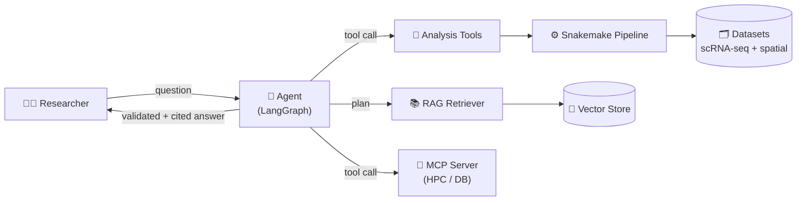
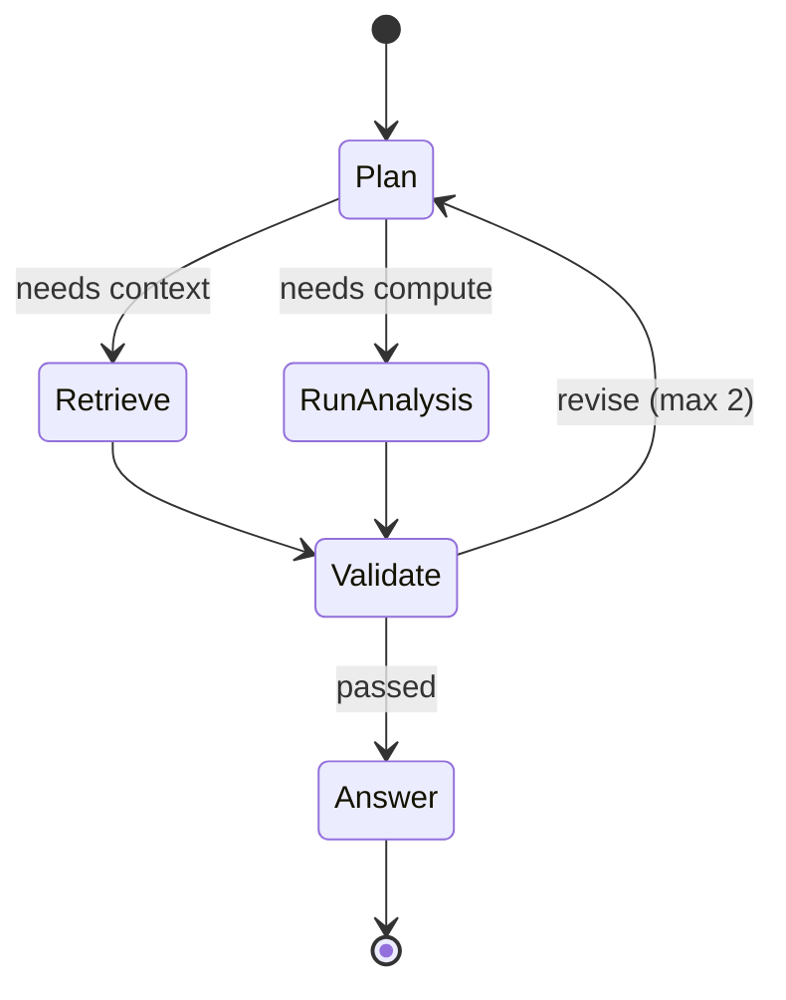
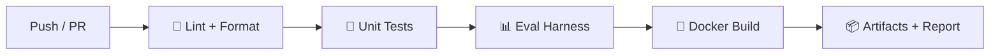

# 🧬 Agentic Bioinformatics Assistant

> **An LLM-powered research assistant for single-cell & spatial omics.**
> Built with LangChain/LangGraph, reproducible pipelines, and continuous evaluation — from code to rendered diagrams.

[](https://github.com/sergiolitwiniuk85/agentic-bioinformatics-portfolio/actions)
[](https://www.python.org/)
[](https://www.langchain.com/)
[](https://langchain-ai.github.io/langgraph/)
[](LICENSE)

---

## What is this?

A portfolio project that proves **end-to-end agentic bioinformatics**: an AI agent that takes a research question, plans it, retrieves *grounded* context (RAG), runs real single-cell / spatial analyses through typed tools, **validates its own output**, and answers with citations — all wrapped in reproducible CI/CD.

The diagrams on this page are **written as Mermaid code and rendered directly by GitHub**. Change the code, the diagram updates.

---

## Architecture



## Agent workflow (state machine)



## CI / evaluation pipeline



---

## ✨ Features

- 🧠 **Agentic workflow** (LangGraph) — `plan → retrieve → run → validate → answer`
- 📚 **RAG** over protocols & literature with **citation-aware** answers
- 🔧 **Tool calling** — run analyses, query results, list datasets (typed schemas)
- 🔌 **MCP integration** for HPC / database resources
- 🧬 **Real omics** — single-cell RNA-seq, spatial transcriptomics, perturbational
- ⚙️ **Reproducible** Snakemake pipeline with provenance logs
- 📊 **Continuous evaluation** — correctness, reproducibility, RAG faithfulness, privacy
- 🐳 **CI/CD** — GitHub Actions + Docker

---

## 🧰 Tech stack

| Layer | Tools |
| --- | --- |
| LLM + agents | LangChain, LangGraph |
| RAG | Chroma |
| Omics | scanpy, anndata, squidpy, decoupler |
| Workflow | Snakemake |
| CI/CD | GitHub Actions, Docker |
| Packaging | uv + pyproject.toml |

---

## 🚀 Quickstart

```bash
git clone https://github.com/sergiolitwiniuk85/agentic-bioinformatics-portfolio.git
cd agentic-bioinformatics-portfolio

# core package (light)
pip install -e . pytest ruff

# full agent + omics stack (heavy, optional)
# uv sync --extra agent --extra omics

pytest -q
```

---

## 📁 Project structure

```
.
├── .github/workflows/ci.yml   # CI pipeline (lint → test → eval → docker)
├── src/agentic_bio/           # package source
├── tests/                     # unit + smoke tests
├── docs/                      # architecture & Mermaid diagrams
├── pyproject.toml             # project config + dependencies
├── LICENSE
└── README.md
```

---

## 🗺️ Roadmap

| Version | Scope |
| --- | --- |
| **v0.1 (beta)** | scaffold, CI, architecture — *this repo* |
| v0.2 | data fixtures + Snakemake pipeline |
| v0.3 | LangChain tools + RAG |
| v0.4 | LangGraph agent + MCP |
| v0.5 | eval harness + benchmark |
| v1.0 | docs, demo, workshop |

---

## 📜 License

[MIT](LICENSE)
