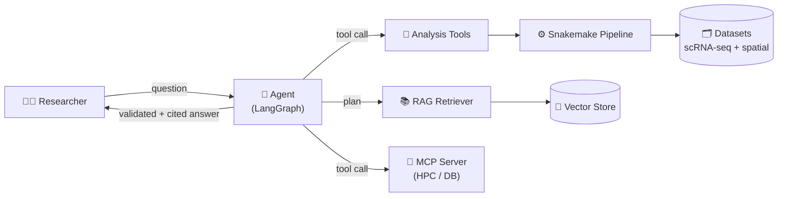
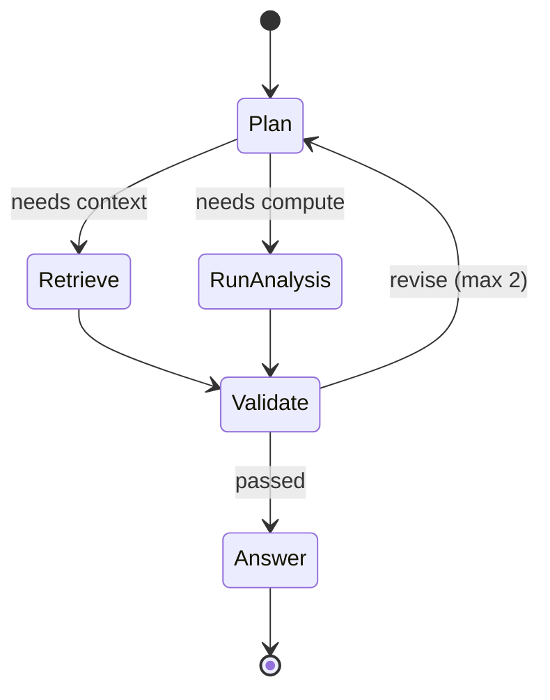
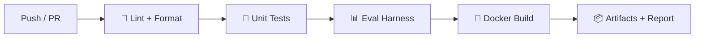

# Architecture

Diagrams are authored as **Mermaid** and rendered directly by GitHub — edit the code, the diagram updates.

## System architecture

## Agent state machine

## CI / evaluation pipeline

